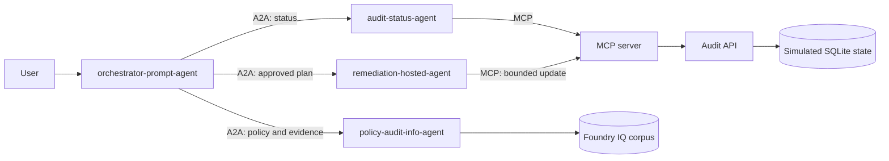

# Microsoft Foundry, MCP, and A2A Workshop

A hands-on workshop that builds a working multi-agent system on Microsoft Foundry, using an oil-and-gas audit scenario as the domain.

You start with a single grounded agent and finish with an orchestrator that routes across three specialist agents, calls live tools over MCP, and performs a human-approved remediation.

> **Workshop disclaimer:** This is a conceptual proof of concept. The audit data and remediation actions are simulated for learning. This workshop does not provide legal advice, certify regulatory compliance, or replace human review and production authorization controls.

## What you build



By the end you will have four agents working together:

| Agent | Type | Role |
|---|---|---|
| `policy-audit-info-agent` | Prompt | Answers policy and audit questions, grounded in the Foundry IQ corpus with citations |
| `audit-status-agent` | Prompt + MCP | Reads live compliance ratings and root-cause violations from the audit API |
| `orchestrator-prompt-agent` | Prompt + A2A | Routes requests to the specialists and enforces the approval gate |
| `remediation-hosted-agent` | Hosted (C#) | Applies one explicitly approved, bounded remediation |

## Concepts covered

- **Microsoft Foundry** — agent hosting, model deployments, playground, tracing, and managed identity
- **Foundry IQ** — retrieval-grounded answers with citations over a document corpus
- **MCP (Model Context Protocol)** — connecting agents to live HTTP tools
- **A2A (Agent-to-Agent)** — agent cards, Entra-authenticated agent connections, and routing
- **Hosted agents** — publishing containerized C# agent code to Foundry
- **Human-in-the-loop approval** — separating analysis from action

## Workshop parts

Complete these in order. Each part builds on the previous one.

| Part | Guide | What you do |
|---|---|---|
| 1 | [docs/Part1.md](docs/Part1.md) | Create the Foundry resource and project, deploy a model, upload the corpus, configure Foundry IQ, and build `policy-audit-info-agent` |
| 2 | [docs/Part2.md](docs/Part2.md) | Deploy the audit API and MCP server to Azure Container Apps, then build `audit-status-agent` on MCP tools |
| 3 | [docs/Part3.md](docs/Part3.md) | Enable A2A on both agents, verify their agent cards, and create `orchestrator-prompt-agent` to route between them |
| 4 | [docs/Part4.md](docs/Part4.md) | Publish the hosted C# `remediation-hosted-agent`, wire it as a third A2A connection, and validate the approval workflow |
| 5 | [docs/Part5.md](docs/Part5.md) | Explore agent telemetry in the Application Insights **Agents (Preview)** blade and verify multi-agent routing at the trace level |
| — | [docs/End.md](docs/End.md) | Recap and follow-on use cases |

## Prerequisites

- An Azure subscription with permission to **create resources and assign RBAC roles** on the Foundry resource and storage account
- Model quota for a **GPT 5.2 or higher** deployment (GPT-5.4 recommended)
- [Azure CLI](https://learn.microsoft.com/cli/azure/install-azure-cli) (`az`), logged in via `az login`
- [PowerShell 7+](https://learn.microsoft.com/powershell/scripting/install/installing-powershell)
- [.NET 10 SDK](https://dotnet.microsoft.com/download) (Parts 2 and 4)
- [Docker](https://docs.docker.com/get-docker/) (Part 2 container builds)

Role assignment permission matters — several steps grant identities access to the Foundry project. If you cannot assign roles, arrange for a subscription or resource owner to help before starting.

## Conventions used in the guides

The guides use fixed names so commands can be copied directly. Substitute your own initials where indicated.

| Value | Convention |
|---|---|
| Resource group | `rg-agent-ws-mx01` |
| Foundry project | `main-project` |
| Foundry resource | `foundry-agent-test-<initials>-mx01` |
| Model deployment | `gpt-5.4-nano-deployment` |

Copy-paste content — agent instructions and validation prompts — appears in fenced code blocks with a copy button. Blockquotes are notes and warnings meant to be read, not copied.

> **Agent connection names** are routing identifiers referenced directly in agent instructions. Use the exact names given in the guides, and note that Foundry limits them to 27 characters.

## Repository layout

```
docs/                    Workshop guides (Part1-Part5, End)
data/docs/               144-document policy and audit corpus for Foundry IQ
src/api/                 Audit API (Python/FastAPI) — simulated compliance data
src/mcp/                 MCP server (C#) — exposes audit tools to agents
src/remediation-agent/   Hosted remediation agent (C#)
scripts/                 Deployment and setup automation (PowerShell)
infra/                   Bicep templates for Azure Container Apps
```

### Key scripts

| Script | Purpose |
|---|---|
| `scripts/corpus-upload.ps1` | Uploads the corpus to blob storage for Foundry IQ |
| `scripts/setup-part2.ps1` | Deploys the audit API and MCP server end to end |
| `scripts/deploy-mcp.ps1` | Rebuilds and redeploys the MCP server |
| `scripts/get-mcp-url.ps1` | Prints the MCP server URL |
| `scripts/enable-a2a.ps1` | Enables incoming A2A on an agent and prints its A2A endpoint |
| `scripts/verify-agent-card.ps1` | Retrieves an agent card to confirm A2A is live |
| `scripts/grant-a2a-access.ps1` | Grants the caller the Foundry Agent Consumer role |
| `scripts/publish-agent.ps1` | Builds and publishes the hosted remediation agent |

## The scenario

Seven simulated audit areas are tracked, each with a rating (`Compliant`, `At Risk`, `Non-compliant`) and root-cause violations:

`spcc-compliance` · `psm-program` · `subpart-w-ghg` · `rcra-waste` · `pipeline-safety` · `environmental-controls` · `incident-corrective`

Always use these hyphenated IDs in tool calls — display names and underscore variants are not canonical.

The end-to-end flow: ask the orchestrator about a non-compliant area, it gathers live status over MCP and policy evidence from Foundry IQ, proposes a remediation plan, and waits. Only after explicit approval does it call the hosted agent to apply the bounded change, then re-checks status to verify.

Audit state lives in SQLite inside the API container, so **restarting the container app resets the data** to its non-compliant baseline for a clean run.

## Troubleshooting

| Symptom | Likely cause |
|---|---|
| `Agent task ... failed` with no trace detail | The hosted agent's `modelDeploymentName` does not match a deployment that exists in your Foundry account |
| Tool returns 404 for an audit area | An underscore or display name was used instead of the canonical hyphenated ID |
| Orchestrator says it is "waiting for agent results" | Agent connection names in the instructions do not match the registered connections |
| Redeployed code does not take effect | Azure Container Apps kept the prior revision; deploy with a new revision suffix |
| A2A call returns 401 | The calling identity is missing **Foundry Agent Consumer**, or the hosted agent identity is missing **Foundry User** on the project |

Check agent traces in the Foundry playground first — they show which tool was called and with what arguments.
