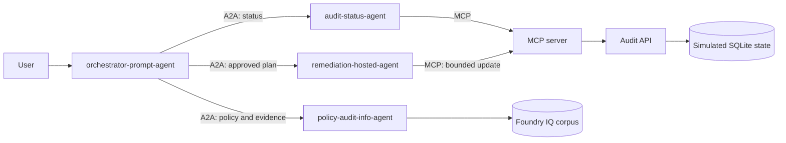

# Workshop Complete

Congratulations on completing the Microsoft Foundry, MCP, and A2A workshop.

You built and connected a small oil-and-gas audit proof of concept. The workflow combines Foundry agents, Foundry IQ grounding, MCP tools, A2A connections, and a hosted C# remediation agent.

## What you built

- **Foundry** hosted the agents and provided the playground, identity, tracing, and model access.
- **Foundry IQ** grounded policy and audit responses in the workshop corpus.
- **MCP** connected `audit-status-agent` and the hosted remediation agent to the audit API.
- **A2A** connected the prompt orchestrator to the specialist agents.
- **Human approval** controlled the transition from analysis to the simulated remediation update.
- **Fresh verification** confirmed the changed status through `audit-status-agent`.
- **Application Insights** captured agent runs, tool calls, model token usage, and end-to-end traces across every component.

## Next use cases to explore

| Use case | How the workshop architecture could support it |
|---|---|
| **SPCC readiness review** | Add an SPCC-focused policy prompt agent or knowledge source. Reuse `audit-status-agent` for current findings and add a bounded MCP remediation for containment inspections, training, or plan maintenance. |
| **Incident corrective actions** | Add incident-history MCP tools and route incident questions to a specialist agent. A hosted agent could apply an approved corrective-action update, followed by fresh verification. |
| **Permit and evidence readiness** | Extend the Foundry IQ corpus with permits, inspection records, and evidence checklists. Have the orchestrator compare findings with required evidence and produce a gap plan without changing data. |
| **Cross-facility comparison** | Add a facility identifier to the MCP tools and audit data model. The status agent could compare scorecards while the policy agent explains differences using facility-specific evidence. |
| **Change-management review** | Add MCP tools for proposed equipment or process changes. A policy agent could identify required MOC and PHA evidence, while the orchestrator routes an approved checklist to a bounded hosted workflow. |
| **Evidence package preparation** | Add MCP tools that collect references and generate a review package. A human reviewer would approve the package before it is exported or sent to another system. |
| **Independent plan review** | Add a critic or evidence-review agent through A2A. The orchestrator would require its review before presenting a remediation plan for approval. |

For each new use case, keep the same pattern: add grounded evidence, expose narrowly scoped MCP operations, route work through the prompt orchestrator, require explicit human approval before changing state, and verify the result with a fresh read.

## Important boundary

This workshop is a conceptual proof of concept for learning. The data is simulated, the remediation is intentionally bounded, and the approval flow is instructional. It is not production-grade compliance software, does not provide legal advice, does not certify regulatory compliance, and must not be used to make operational or regulatory decisions without qualified human review and substantial engineering hardening.
